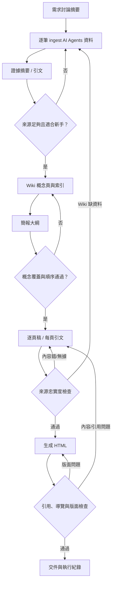

# 作業說明｜AI Agents 入門

## 1. LLM Wiki 主題與簡介
**主題：AI Agents 入門。** Wiki 為新手整理 Agent 的基本構成、外部工具、行動—觀察循環、workflow/agent 模式與可靠性注意點。五筆資料全部是 AI Agents 官方文件或原始研究論文。課堂 PDF 只作為作業流程參考，沒有 ingest，也沒有作為簡報內容來源。

## 2. Wiki 與簡報成果
- [Wiki 索引](wiki/index.md)
- [Ingest 紀錄](wiki/log.md)
- [教學 HTML 簡報](deck.html)
- [五份 raw source notes](raw/)

這是本機 Wiki，不是公開部署的服務；HTML 可直接開啟。

## 3. 先討論、後生成
需求摘要列在 [需求討論摘要](workflow/需求訪談摘要.md)：先確定新手讀者、學習目標、繁中/HTML 格式、五筆資料類型、引用與來源衝突處理，再產生目錄及規則檔；之後逐篇 ingest。來源涵蓋供應商文件、框架模式文件和研究論文，並保留各自範圍與時效限制。

## 4. Loop / Graph 設計

**重複節點**：來源擷取及證據整理依每份來源重跑；逐頁稿與 HTML 內部保留小型修正 loop。**檢查/重生成**：Wiki 覆蓋不足回 ingest；大綱缺主題回 Wiki/大綱；個別頁錯回該頁或來源卡；版面錯留在 HTML 節點。**為什麼**：不同錯誤的成因不同，在最近節點檢查能減少整份重做；停止條件避免 Agent 概念教學把研究結果過度推廣。

## 5. 一次實際執行結果與檢查紀錄
已將主題從先前版本改為 AI Agents，重建五份 raw source notes、Wiki 頁、索引與 10 頁簡報。五筆來源為 OpenAI Agents、Anthropic Building effective agents、LangGraph Workflows and agents、ReAct 論文及 Toolformer 論文。詳細檢查結果及限制列於 [執行紀錄](evidence/run-2026-11-23.md)。

## 6. 反思
**最容易出錯的節點**：逐頁撰稿，特別是將某篇研究的 benchmark 結果過度概括成「Agent 一定更好」，或把 Toolformer 訓練方法混同部署時的工具呼叫。**檢查往前移**：先在 ingest 卡片標示研究設定、產品文件時效與概念限制；大綱先覆蓋基本定義/差異/例子/限制；逐頁檢查每個主張的來源再生成 HTML。**Workflow 修改**：新增「研究結果適用範圍」和「產品文件時效」兩個證據檢查，並為內容錯與排版錯分開退回路徑。因為兩類錯誤需要不同修正，不能用一次成品通讀代替來源層的檢查。
